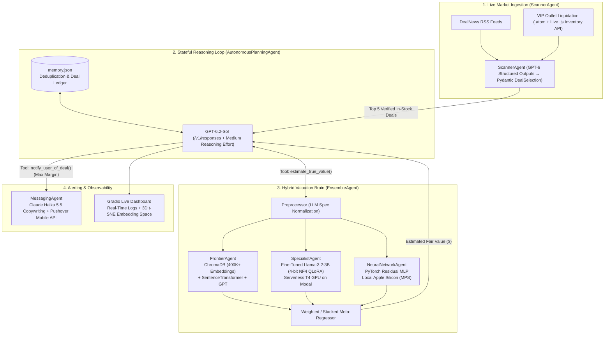

<div align="center">

# LLM Engineering & Autonomous Multi-Agent Systems

**End-to-End Applied AI Engineering Portfolio — Fine-Tuning (QLoRA), Production RAG, Deep Neural Networks, Serverless GPU Inference, and Autonomous Tool-Calling Agents**

[](https://www.python.org/)
[](https://pytorch.org/)
[](https://huggingface.co/jayalexander)
[](https://modal.com/)
[](https://www.trychroma.com/)
[](https://platform.openai.com/)

**Author:** [Jay Rodriguez](https://github.com/JayR1031) · M.S. Computer Science / Machine Learning @ Northeastern University  
**Hugging Face Hub:** [`huggingface.co/jayalexander`](https://huggingface.co/jayalexander)

</div>

---

## Flagship Capstone (`week8/`): Autonomous Deal & Liquidation Arbitrage Engine

The culmination of this repository is **The Price is Right** — a stateful, autonomous multi-agent system that continuously monitors retail and wholesale liquidation feeds, estimates true secondary-market value through a **3-model hybrid ML/LLM ensemble**, identifies high-margin mispricings, persists state to `memory.json`, streams live 3D vector visualizations in **Gradio**, and dispatches real-time push alerts to mobile via **Pushover**.

### System Architecture



---

## Key Engineering Highlights & Custom Upgrades

Beyond the core curriculum, this implementation includes custom production upgrades across ingestion, reasoning, and valuation:

### 1. Live Liquidation Inventory & Variant Pricing Scraper (`week8/agents/deals.py`)
- Extended `ScrapedDeal` beyond static DealNews HTML to ingest **VIP Outlet Shopify `.atom` liquidation feeds** (`Electronics` & `Computers/Laptops`).
- Solved the multi-variant price-range problem (`$296 – $476`) by querying Shopify's storefront `.js` JSON endpoint per product, filtering strictly for `available == True` SKUs, discarding sold-out ghost listings, and surfacing the exact lowest in-stock variant price and condition (`New Damaged Box`, `Refurbished`, `Used`).
- **Live Arbitrage Example Captured in [`week8/memory.json`](week8/memory.json):**
  - *Item:* Refurbished ASUS TUF Gaming A16 (`16" WUXGA`, `Ryzen 7 7445HS`, `RTX 4050 6GB`, `16GB RAM`, `512GB SSD`)
  - *VIP Outlet Price:* **`$679.00`** · *Ensemble Valuation:* **`$1,022.73`** · *Captured Margin:* **`+$343.73`**

### 2. Stateful Reasoning Tool Loop on OpenAI `/v1/responses` (`week8/agents/autonomous_planning_agent.py`)
- Migrated `AutonomousPlanningAgent` from legacy `/v1/chat/completions` to OpenAI's **`/v1/responses`** architecture running **`gpt-6.2-sol`** with `reasoning={"effort": "medium"}`.
- Preserves encrypted reasoning items across multi-turn `function_call` / `function_call_output` cycles (`scan_the_internet_for_bargains` → `estimate_true_value` × $N$ → `notify_user_of_deal`).

### 3. QLoRA Fine-Tuned Llama-3.2-3B Deployed on Modal Serverless GPUs (`week8/pricer_service2.py`)
- Curated tokenized Amazon product datasets on Hugging Face ([`jayalexander/items_prompts_full`](https://huggingface.co/jayalexander)) aligned to power-of-2 sequence lengths for GPU Tensor Core efficiency.
- Fine-tuned **`meta-llama/Llama-3.2-3B`** with **4-bit NormalFloat (`nf4`) double quantization + PEFT LoRA adapters** ([`jayalexander/price-2026-11-17_08.04.09`](https://huggingface.co/jayalexander/price-2026-11-17_08.04.09)).
- Deployed as an autoscaling cloud GPU service on **Modal** using `@modal.enter()` warm container lifecycle hooks and a persistent Hugging Face `Volume` cache (`/cache`) to eliminate cold-start weight downloads.

### 4. Multi-Paradigm Valuation Ensemble & Meta-Learning (`week8/day2.ipynb`, `week8/agents/ensemble_agent.py`)
- Combines three orthogonal modeling paradigms whose failure modes cancel out:
  1. **Retrieval-Augmented Frontier LLM (`FrontierAgent`):** Queries `ChromaDB` (`all-MiniLM-L6-v2` 384-d embeddings over 400,000+ products) to ground zero-shot LLM pricing in 5 nearest-neighbor comparables.
  2. **Parametric Domain Specialist (`SpecialistAgent`):** Remote RPC call to the QLoRA-tuned Llama-3.2-3B model on Modal.
  3. **Deep Residual Neural Network (`NeuralNetworkAgent`):** Deep PyTorch MLP with `ResidualBlock` skip connections trained with `L1Loss` on Apple Silicon (`mps`).
- Explored **Stacking (Level-1 Linear Regression Meta-Learner)** on held-out `validation` predictions (`frontier`, `specialist`, `dnn`, `min`, `max`) to learn optimal trust weights and systematic bias correction without leaking `test` data.

---

## 8-Week Engineering Progression

| Module | Core Focus | Key Systems & Artifacts Built |
| :--- | :--- | :--- |
| **[`week1/`](week1/)** | **Frontier & Local LLM Foundations** | Multi-provider API orchestration (`OpenAI`, `Anthropic`, `Ollama`), streaming token pipelines, web-scraping brochure generator. |
| **[`week2/`](week2/)** | **Multi-Modal UIs, Tool Calling & Multi-Agent Chat** | Function-calling assistants, SQLite-backed airline agent, adversarial/collaborative multi-LLM conversations, Gradio UIs + TTS/vision. |
| **[`week3/`](week3/)** | **Hugging Face Ecosystem & Open-Source Pipelines** | Tokenizers (`AutoTokenizer`), quantized `transformers` pipelines on GPU, Whisper speech-to-minutes meeting synthesizer, synthetic data generation. |
| **[`week4/`](week4/)** | **Code Generation & High-Performance Transpilation** | Automated Python $\rightarrow$ C++ / Rust performance transpilers achieving orders-of-magnitude execution speedups benchmarked natively on Apple Silicon. |
| **[`week5/`](week5/)** | **Production RAG From Scratch & Vector Stores** | Chunking strategies, embedding spaces (`t-SNE` 2D/3D projections), `ChromaDB` vector retrieval, query rewriting, reranking, and RAG evaluation (`MRR`, `nDCG`, `Recall@K`). |
| **[`week6/`](week6/)** | **Classical ML vs. Deep Learning vs. Frontier LLMs** | 800K+ Amazon dataset curation, async **Groq Batch API** preprocessing, rigorous `Tester` benchmark harness (`MAE`, `MSE`, $R^2$), `RandomForest` / `XGBoost` vs. custom PyTorch **Residual Deep Neural Network**. |
| **[`week7/`](week7/)** | **Parameter-Efficient Fine-Tuning (PEFT / QLoRA)** | 4-bit `bitsandbytes` NF4 quantization, LoRA rank/alpha/target-module ablation, `SFTTrainer` training runs tracked in Weights & Biases, pushing adapters to Hugging Face Hub. |
| **[`week8/`](week8/)** | **Serverless GPU Deployment & Autonomous Agentic AI** | Modal GPU microservices, 400K-item Chroma RAG, 3-model Ensemble, live DealNews + VIP Outlet RSS/JSON scrapers, `gpt-6.2-sol` `/v1/responses` planner, Claude + Pushover mobile alerts, live Gradio dashboard. |

---

## Quickstart: Running the Capstone (`week8/`)

### 1. Environment & Dependencies
This repo uses **[`uv`](https://docs.astral.sh/uv/)** for fast, reproducible Python 3.12 dependency management:

```bash
git clone https://github.com/JayR1031/llm_engineering.git
cd llm_engineering
uv sync
```

Create a `.env` file in the repository root:

```bash
OPENAI_API_KEY=sk-...
ANTHROPIC_API_KEY=sk-ant-...
HF_TOKEN=hf_...
PUSHOVER_USER=u...
PUSHOVER_TOKEN=a...
```

### 2. Deploy the Fine-Tuned Llama-3.2-3B Specialist to Modal
```bash
cd week8
uv run modal deploy pricer_service2.py
```

### 3. Launch the Autonomous Deal-Hunting Dashboard
*(Note: Ensure `week8/products_vectorstore` is populated via `week8/day2.ipynb` and `week8/deep_neural_network.pth` is placed in `week8/`.)*

```bash
cd week8
uv run price_is_right.py
```

This launches the **Gradio** web interface in your browser, renders the 3D `t-SNE` embedding plot of your product vector database, runs the autonomous `gpt-6.2-sol` planning loop every 5 minutes, logs live multi-agent collaboration, and sends high-margin deal alerts directly to your phone via Pushover.

---

## Acknowledgments

Built while completing and extending [Ed Donner's LLM Engineering curriculum](https://github.com/ed-donner/llm_engineering) ([original setup guides](./setup/SETUP-new.md)).
